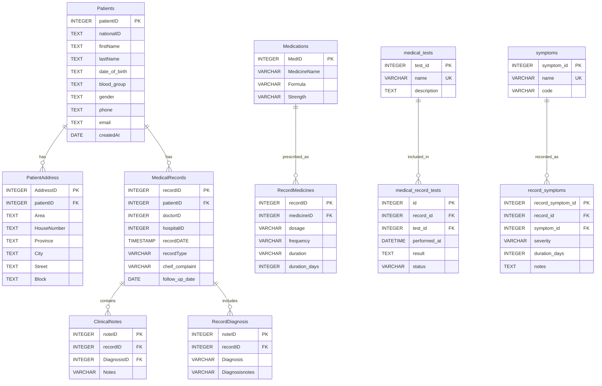

# Entity relationship diagram

This diagram reflects the SQLAlchemy models currently in `app/models`. Column names and declared SQLAlchemy types are shown; `PK` and `FK` mark primary and foreign keys.

## Foreign key references that do not resolve to a defined model table

- `ClinicalNotes.DiagnosisID` references `Diagnosis`, but no `Diagnosis` table/model is defined.
- `RecordMedicines.recordID` is a primary key but has no declared foreign key to `MedicalRecords`.
- `medical_record_tests.record_id` references `medical_records.record_id`, while the defined `MedicalRecords` model table is `MedicalRecords` with key `recordID`.
- `record_symptoms.record_id` has the same unresolved `medical_records.record_id` reference.
- `doctorID` and `hospitalID` have no foreign key declarations or corresponding models in the current folder.

The PII columns in `Patients` and address columns in `PatientAddress` are `TEXT`, including `date_of_birth`, to accommodate variable-length encrypted strings.
